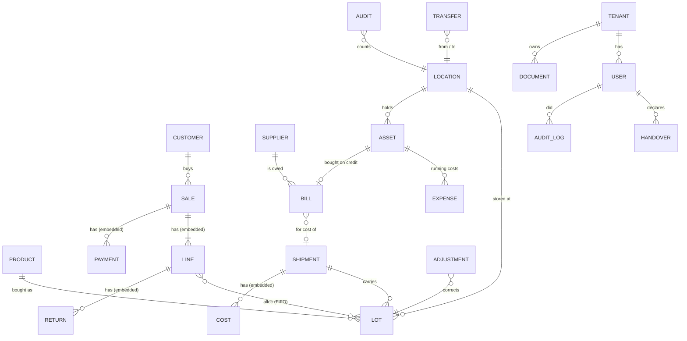

# 4. Database (PostgreSQL 14+)

- Full schema: `database/schema.sql`. It is all the migrations concatenated, so it can be read or run on an empty database.
- In practice, run `npm run migrate` in `server/`. It applies `server/migrations/NNN_*.sql` in order and records each one in `schema_migrations`.

| Migration | Adds |
|---|---|
| 001_init | tenants, users, documents (JSONB), audit_log, first views |
| 002_roles_images | roles + per-user permission overrides, images (bytea) |
| 003_locations_reminders | users.location_id, reminder_runs |
| 004_custom_roles | removes the fixed role check, so custom roles from `settings.roles` work |
| 005_activity | audit_log.user_name, location_id + indexes for the activity log |
| 006_reporting_views | v_sales, v_sale_lines, v_payments, v_lots, v_products, v_customers + updated_at index |
| 007_assets | v_assets (business assets register) |

## Entity relationships (logical: the links are ids inside the JSON documents)


## Useful queries
```sql
-- Revenue and cash collected per day, last 30 days
SELECT sale_date, SUM(total) revenue, SUM(paid) collected
FROM v_sales WHERE tenant_id=$1 AND status<>'cancelled' AND sale_date > now()-interval '30 days'
GROUP BY 1 ORDER BY 1;

-- Best sellers by quantity
SELECT name, SUM(qty-returned_qty) units, SUM(line_total) revenue
FROM v_sale_lines WHERE tenant_id=$1 GROUP BY name ORDER BY units DESC LIMIT 20;

-- Who owes money
SELECT customer_name, SUM(total-paid) owed FROM v_sales
WHERE tenant_id=$1 AND status<>'cancelled' AND total>paid GROUP BY 1 ORDER BY 2 DESC;

-- Collections per payment method this month
SELECT method, SUM(amount) FROM v_payments
WHERE tenant_id=$1 AND pay_date >= date_trunc('month', now()) GROUP BY 1;

-- Asset register (value today comes from compute.js; this lists what was bought)
SELECT tag, name, category, status, location_id, purchase_date, price, currency, extra_costs FROM v_assets WHERE tenant_id=$1 ORDER BY tag;

-- Who changed a sale and when
SELECT at, user_name, action FROM audit_log WHERE tenant_id=$1 AND collection='sales' AND doc_id=$2 ORDER BY at;
```
**Profit and landed cost** are *not* computed in SQL. Cost allocation (freight and customs spread by value, car-only costs, FIFO lots, returns) lives in `compute.js` so the browser, the server and the reports agree. Use the in-app reports or the Excel export for profit. If SQL profit is needed later, compute `landedUnit` per lot on write and store it in the lot document.

## Backups
- **Server:** run `pg_dump` nightly. Managed Postgres such as Neon, Supabase, RDS or Render does this for you.
- **Business-level:** in the app, Settings → Backup produces a JSON file with every collection plus photos. It can be restored through the app or with `npm run import-backup -- <file> <owner login>`.
- The same backup file moves data between the hosted build and the SaaS build.
